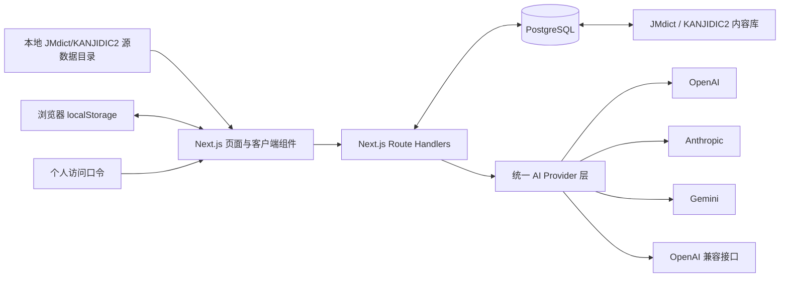
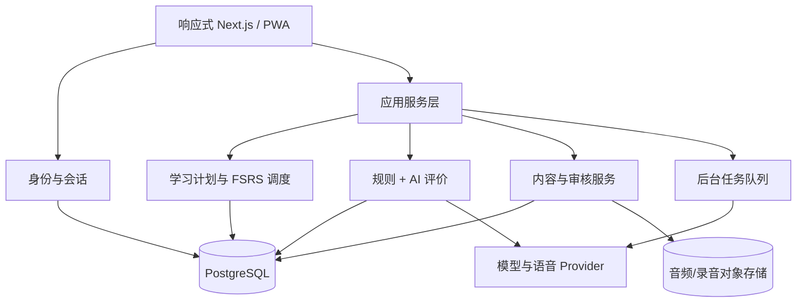

# 日々（Hibi）项目主文档

## 1. 文档定位

本文是项目长期维护的产品与技术主文档，服务于产品决策、开发实施和新会话交接。它包含长期目标、已确认需求、学习机制、架构设计、当前实现状态和后续路线。

文档状态：

- 最近核对日期：2026-08-03
- 当前阶段：个人学习闭环 Alpha 阶段
- 当前分支：`main`
- 基线提交：`5dbaf3c feat: bootstrap Japanese learning MVP`
- 主要用户：项目所有者本人
- 第一课程范围：可跳过的假名入门与 JLPT N5

状态定义：

- **已实现**：主要代码路径存在，并通过与风险相称的检查。
- **部分实现**：已有页面、接口或原型，但业务闭环、持久化、质量或验证尚不完整。
- **未实现**：只有设计目标，尚无可用代码路径。

## 2. 产品愿景

日々不是单纯的背词或 JLPT 刷题工具，而是一套以长期记忆和真实语言使用为目标的日语学习系统。

产品希望解决三个核心问题：

1. 学习者知道“学过什么”，却不知道“今天最该复习什么”。
2. 学习者能做选择题，却难以在真实语境中听懂、写出或说出日语。
3. 通用学习内容与个人目标、兴趣、错误类型和可用时间脱节。

产品愿景是覆盖 N5 到 N1，并将 JLPT 等级路径与听、说、读、写的真实能力目标结合。系统通过可靠基础数据、自建课程结构、间隔复习和 AI 个性化反馈，为学习者持续生成恰当的下一步。N4–N1 不是等待多年后再处理的远期范围：N5 学习闭环验证完成后，应立即补齐这些等级的数据源、课程骨架和基础可浏览内容。

## 3. 业务目标

### 3.1 当前阶段目标

当前阶段先服务单一用户，通过 Web 端验证以下假设：

- 用户愿意每天从“复习优先”的今日任务进入学习。
- 已有基础的用户愿意通过“我已掌握”跳过熟悉内容，并接受后续短测验证。
- 文法和单词在例句、对话及短文中的多次出现，比孤立卡片更有价值。
- 主动造句和 AI 反馈能够促进输出，而不只是增加操作成本。
- 模拟考试能够帮助用户验证阶段能力、发现薄弱点并生成后续复习任务。
- 可配置的大模型能在准确性、费用和隐私之间提供可接受的选择。
- 手机与电脑使用同一套响应式体验可以满足个人日常学习。

### 3.2 中期业务目标

- 完成一套高质量 N5 课程和可持续扩展的内容生产流程。
- 建立真实学习记录、复习调度、掌握度与等级进阶。
- 形成稳定的日活学习闭环：今日计划 → 学习 → 输出 → 反馈 → 复习 → 总结。
- N5 学习闭环完成后，立即接入并整理 N4–N1 的可靠基础数据，建立各等级课程骨架和首批可浏览内容。
- 提供按等级、题型和知识范围组织的模拟考试，并将错题和薄弱点接回复习系统。
- 支持在个人 Linux 服务器上可靠部署、备份和升级。
- 通过实际使用数据判断内容密度、每日任务量和 AI 反馈是否有效。

### 3.3 长期业务目标

- 从个人自用扩展为多用户产品，同时保持数据隔离和隐私安全。
- 提供兴趣、职业和生活场景驱动的个性化学习内容。
- 建立内容编辑、审核、版本和错误反馈后台。
- 支持跨设备同步、离线学习、学习数据导入导出。
- 将真实应用能力作为主要成果，同时兼顾 JLPT 备考。

### 3.4 非目标

现阶段不优先：

- 社交、排行榜、好友和社区内容。
- 订阅、支付和商业化。
- 原生 iOS/Android 应用。
- 手写汉字识别。
- 实时口语陪练和发音评分。
- 一次性覆盖完整 N5 到 N1 内容。

## 4. 技术目标

- 使用一套响应式 Web 代码适配手机和电脑。
- 将页面、领域数据、学习调度、AI provider 和持久化清晰分层。
- 当前以 PostgreSQL 和固定单用户身份支持个人试用，后续可平滑迁移到多用户身份体系。
- 大模型服务可替换，不把业务绑定到某个服务商或模型 ID。
- 学习内容和用户进度分离，内容修订不能破坏历史学习记录。
- 所有重要状态可追踪、可解释、可迁移、可测试。
- Linux 部署过程简单，可使用标准 Node.js、反向代理和进程管理工具。
- 默认保护密钥、学习记录、未来录音等敏感数据。

## 5. 已确认的产品范围与默认设置

| 项目 | 决定 |
| --- | --- |
| 目标用户 | 先仅供项目所有者使用，保留多用户扩展能力 |
| 第一等级 | N5 |
| 入门模块 | 包含假名入门，用户可跳过 |
| 界面语言 | 简体中文 |
| 学习内容语言 | 日语，可显示中文解释 |
| 每日新文法 | 默认 10 个，可设置 |
| 每日新单词 | 默认 50 个，可设置 |
| 每日时长 | 默认 30 分钟 |
| 调度原则 | 到期复习优先；时间不足时减少新内容 |
| 熟悉内容 | 文法和单词均可选择“我已掌握”，跳过首次教学并进入短测复习 |
| 模拟考试 | 按等级、题型和知识范围组卷，结果进入薄弱点与复习计划 |
| 第一版语音 | 音频播放和听写 |
| 第二版语音 | 录音、语音识别和发音评分 |
| 模型服务 | OpenAI、Anthropic、Gemini、OpenAI 兼容接口 |
| 开发部署 | 本地开发并提交 Git，用户后续部署到 Linux 服务器 |
| 内容策略 | JMdict 等提供基础事实，自建课程结构，AI 生成适配内容 |
| 内容接入 | 优先接入 JMdict、KANJIDIC2 和官方样题；没有可靠正式来源时不填充示例内容 |

每日 10 个文法和 50 个单词是“新内容上限”，不是必须完成量。如果到期复习较多，或预计超过 30 分钟，系统应自动削减当日新内容。

## 6. 核心用户流程

### 6.1 初次使用

1. 选择界面语言与目标等级。
2. 如果从 N5 开始，选择学习或跳过假名入门。
3. 设置每日时长、新文法和新单词上限。
4. 可选配置 AI 模型。
5. 进入今日任务。

后续可增加轻量分级诊断，批量识别已有基础；这不能替代每个文法和单词上的“我已掌握”选项。

### 6.2 每日学习

1. 系统按用户时区生成当天计划。
2. 优先安排到期复习。
3. 根据剩余时间分配新文法与新单词。
4. 每个新文法或单词都允许用户选择“我已掌握”；选择后跳过首次教学，记录自评状态并安排后续短测。
5. 安排包含当天及旧知识的综合听读材料。
6. 至少完成一次主动输出任务。
7. 展示今日总结、薄弱点和下一次复习安排。

### 6.3 等级进阶

1. 当前等级知识点达到综合掌握标准。
2. 没有大量逾期复习。
3. 完成等级综合检测。
4. 系统建议进入下一等级。
5. 用户可以接受、延后，或手动浏览其他等级。

### 6.4 模拟考试

1. 用户选择目标等级、知识范围、题型和考试时长；系统也可推荐当前阶段适合的试卷。
2. 考试过程使用独立会话，记录题目版本、作答、耗时和是否使用辅助。
3. 提交后展示总分、各能力维度、错题解释和薄弱知识点，不只显示单一分数。
4. 错题和低置信度知识点可一键加入后续复习，但单次考试结果不能直接永久改变综合掌握状态。
5. 系统保留历次考试记录，用于比较阶段变化和判断是否适合进入下一等级。

## 7. 学习机制

### 7.1 知识点模型

文法和单词不是单一正反面卡片，而是可被多个练习引用的知识点。

每个知识点至少包含：

- 稳定标识和内容版本。
- 等级、主题、难度和先修关系。
- 核心事实、解释、例句和音频。
- 来源、许可和审核状态。
- 多种练习模板。
- 用户在不同能力维度上的状态。

### 7.2 文法学习路径

1. 场景或例句引入。
2. 理解含义、接续、语气和使用限制。
3. 比较正确、错误和易混淆表达。
4. 进行识别、选择、组句和填空。
5. 用户自由造句。
6. 在对话中使用目标文法。
7. 在短文中理解或续写。
8. 通过听力识别和听写巩固。
9. 在后续综合材料中间隔重现。

### 7.3 单词学习路径

单词内容包括汉字、假名、中文释义、词性、常见搭配、语域、音频、例句、相关词和易混淆词。

练习由浅入深：

- 日文识别中文。
- 中文主动回忆日文。
- 听音辨义。
- 假名或汉字听写。
- 选词填空与搭配判断。
- 自由造句。
- 在对话和短文中理解。

系统应根据薄弱维度出题。例如“能看懂但写不出”时，应增加主动回忆与听写，而不是继续堆叠选择题。

### 7.4 听、说、读、写

- **听**：正常速度、慢速、隐藏文字播放、听写、对话理解。
- **说**：第二阶段加入跟读录音、语音转写、漏词和流畅度反馈。
- **读**：分级例句、对话、短文、振假名开关、点击查词和理解题。
- **写**：假名输入、听写、组句、自由造句、短日记和场景写作。

### 7.5 复习调度

目标采用 FSRS 一类基于记忆状态的间隔复习，而不是固定的 1/3/7/14 天计划。

每次作答应写入复习日志，包括：

- 知识点与内容版本。
- 练习类型和能力维度。
- 回答、正确性、耗时和提示次数。
- 用户自评或难度反馈。
- AI 或规则评价及其版本。
- 复习前后状态与下一次到期时间。

每日调度逻辑：

1. 获取已到期和即将遗忘的项目。
2. 按风险、重要性和逾期程度排序。
3. 估算复习用时。
4. 在剩余时间中分配新内容。
5. 控制同类任务连续出现的数量。
6. 安排综合材料促进迁移。

### 7.6 掌握定义

不能以一次答对作为“完全掌握”。每个知识点应分别评估：

- 看见能理解。
- 听见能理解。
- 能主动回忆。
- 能正确读出。
- 能正确书写。
- 能在句子中使用。
- 能在真实上下文中理解。

建议的掌握条件：

- 跨天多次成功复习。
- 记忆稳定度或预期保留率达到阈值。
- 至少一次无提示主动输出成功。
- 至少一次对话或短文情境理解成功。
- 近期没有反复出现的关键错误。

进入“已掌握”后仍应安排长间隔维护复习。

### 7.7 用户自报“我已掌握”

“我已掌握”是用户对已有基础的声明，用于减少重复教学，不等同于系统验证的综合掌握。

- 每个文法和单词首次进入学习时都提供该选项。
- 选择后跳过讲解和首次练习，写入自评来源、时间与对应内容版本，并初始化复习状态。
- 到期复习优先安排一个简短、低负担的测验；题型至少应能验证识别或主动回忆，不能只让用户再次确认“会了”。
- 短测通过后逐步延长复习间隔；失败、连续犹豫或主动撤销时，知识点回到正常学习或加强复习队列。
- 调度和统计必须区分“用户自报掌握”“短测验证通过”和“满足多维条件的综合掌握”。

## 8. 内容策略

### 8.1 原则

不能把全部课程事实和等级判断交给大模型，也不能未经处理直接使用网络词表。

内容由四层组成：

1. **基础事实层**：许可明确的词典和汉字数据。
2. **课程结构层**：项目自建的等级、顺序、先修和教学目标。
3. **教学内容层**：原创例句、对话、短文和练习。
4. **质检发布层**：规则检查、模型复核、人工修订和版本管理。

### 8.2 数据源

- JMdict：词条、读音、词性和释义候选。
- KANJIDIC2：汉字读音和含义等信息。
- JLPT 官方资料：能力描述、题型和难度方向。
- Tatoeba：只作为可选候选例句来源，逐条核对许可、署名和自然度。

JLPT 官方不提供新版考试的完整词汇、汉字和文法清单。因此项目中的 N5–N1 归类是课程设计结果，不能标注为官方完整范围。

### 8.3 AI 生成内容

适合生成：

- 原创例句。
- 分级对话和短文。
- 填空、组句和选择题。
- 造句题目和难度变体。
- 与用户兴趣相关的练习。
- 错题解释和个性化反馈。

不应由单个模型最终决定：

- 标准读音、词性和核心释义。
- 文法接续规则。
- JLPT 等级归属。
- 内容是否可以合法发布。
- 用户是否永久掌握。

### 8.4 内容质检

发布前至少检查：

- JSON/字段和字符格式。
- 目标词汇或文法是否真实出现。
- 等级外词汇比例。
- 文法正确性和自然度。
- 中文翻译是否忠实。
- 内容是否存在不适宜主题。
- 来源与许可是否完整。
- 内容版本是否可追踪。

## 9. 产品信息架构

一级导航保持五项：

| 页面 | 目标 |
| --- | --- |
| 今日 | 显示时间预算、到期复习、新内容和综合任务 |
| 文法 | 按等级浏览、学习和检索文法 |
| 单词 | 按等级、主题和词性浏览单词 |
| 复习 | 处理到期项目、错题和薄弱维度，并进入模拟考试 |
| 我的 | 管理目标、每日计划、模型、语音和数据 |

移动端使用底部导航，桌面端使用左侧导航。学习页采用单任务模式，减少干扰。

## 10. 当前技术架构



当前架构适合个人原型：

- Next.js App Router 同时承担 Web 页面和后端接口。
- 设置和 API Key 保存在浏览器 localStorage。调用模型时，密钥随请求进入同源 Route Handler，再由服务端发送给第三方 provider。
- 生产环境使用 HTTP Basic 个人访问口令保护页面和 Route Handler；这是单用户部署保护，不是多用户账号体系。
- PostgreSQL、Drizzle schema 和迁移保存固定单用户的掌握声明、作答、复习状态和复习日志。
- 当前词汇学习内容从 Git 忽略的 JMdict/KANJIDIC2 源数据目录读取；完整词典事实也可通过版本化管线保存到 PostgreSQL。没有正式来源的文法内容不再用静态示例填充。
- AI 造句评价通过服务端 Route Handler 调用 provider。
- 浏览器 `speechSynthesis` 提供临时日语朗读能力。

它只适合通过 HTTPS 和个人访问口令保护的单用户部署，不适合公网多用户生产架构，尤其是密钥、用户隔离、完整调度和内容管理部分。

## 11. 目标技术架构

下图是推荐目标，而非已经锁定的实施决定。阶段 A 首先需要确定持久化方案和单用户身份方式；PostgreSQL 是面向 Linux 部署和未来多用户能力的当前首选。



设计要点：

- 推荐由 PostgreSQL 存储用户、内容、进度、复习日志、评价和版本。
- 后台任务生成内容、音频和每日计划，避免阻塞交互请求。
- 对象存储保存正式音频和未来用户录音。
- provider 层统一模型、语音识别和语音合成服务。
- 多用户阶段使用行级数据隔离、服务端密钥管理和审计日志。

## 12. 当前代码结构

```text
.
├── AGENTS.md                # AI 开发规范与 Codex 自动发现入口
├── PROJECT.md               # 产品与技术主文档
├── README.md                # 使用说明
├── deploy                   # systemd 与 Caddy 个人部署模板
├── content/sources.json     # 外部内容源、下载地址、许可与署名配置
├── drizzle                  # PostgreSQL 迁移
├── scripts                  # 数据库验收与词典下载/导入脚本
├── src
│   ├── app
│   │   ├── api/ai           # 模型测试与造句评价接口
│   │   ├── api/content      # 内容来源、版本和许可状态接口
│   │   ├── api/progress     # 掌握与重新学习状态接口
│   │   ├── api/reviews      # 到期队列与复习提交接口
│   │   ├── grammar          # 文法目录与学习页
│   │   ├── kana             # 假名入门
│   │   ├── review           # 复习入口
│   │   ├── settings         # 计划与模型设置
│   │   ├── vocabulary       # 单词目录
│   │   ├── globals.css      # 全局视觉与响应式样式
│   │   ├── layout.tsx       # 根布局
│   │   ├── manifest.ts      # PWA manifest
│   │   └── page.tsx         # 今日首页
│   ├── components           # 导航、首页、学习与朗读组件
│   ├── data/kana.ts         # 假名基础数据
│   ├── db                    # Drizzle 客户端和 schema
│   ├── domain               # 最小复习调度规则
│   └── lib
│       ├── ai/providers.ts  # 多模型统一调用层
│       ├── access.ts        # 单用户部署访问保护
│       ├── progress-service.ts # 进度与复习持久化
│       └── storage.ts       # 浏览器设置持久化
│   └── proxy.ts             # 生产页面入口访问保护
├── package.json
└── tsconfig.json
```

随着业务增长，建议逐步增加：

```text
src/
├── domain/          # 知识点、练习、掌握和调度领域模型
├── application/     # 用例与服务编排
├── infrastructure/  # 数据库、队列、存储和 provider 实现
├── content/         # 内容 schema、导入、校验和版本
└── tests/           # 单元、集成和端到端测试
```

不要为了目录整齐提前进行大规模迁移；应在真实功能引入时逐步形成分层。

## 13. 计划数据模型

核心实体：

| 实体 | 作用 |
| --- | --- |
| User | 用户身份与时区 |
| UserSettings | 等级、每日上限、时间预算、语音和模型偏好 |
| Level | N5–N1 与入门阶段 |
| KnowledgePoint | 文法、词汇、假名或汉字知识点 |
| ContentVersion | 知识内容版本、来源、许可和审核状态 |
| Example | 例句及翻译 |
| Dialogue | 分级对话 |
| Passage | 分级短文 |
| Exercise | 练习定义与评分策略 |
| StudyPlan | 某日计划及生成依据 |
| Attempt | 用户单次作答 |
| ReviewState | FSRS 所需记忆状态 |
| ReviewLog | 复习前后状态及调度结果 |
| MasteryDeclaration | 用户“我已掌握”的自评、撤销、验证状态和对应内容版本 |
| ExamDefinition | 模拟考试范围、题型、时长、组卷规则和版本 |
| ExamSession | 一次考试的试卷快照、作答、耗时、评分和薄弱点 |
| AIEvaluation | 模型、提示词、评分、置信度和原始引用 |
| ProviderConfig | 加密的服务商配置 |
| AudioAsset | TTS 或真人音频及许可 |

内容定义、用户作答和复习状态必须使用稳定 ID 关联，不得因内容修订直接覆盖历史。

## 14. AI 评价设计

### 14.1 当前支持

统一 provider 层支持：

- OpenAI Responses API。
- Anthropic Messages API，并对稳定系统提示使用 prompt caching 标记。
- Gemini generateContent。
- OpenAI 兼容 Chat Completions。

### 14.2 目标评分协议

造句评价应返回结构化字段：

- `target_used`：是否使用目标文法。
- `grammar_score`：语法正确性。
- `naturalness_score`：自然度。
- `context_score`：语境和语域适合度。
- `errors`：问题及位置。
- `minimal_revision`：最小修改版本。
- `alternatives`：可选自然表达。
- `explanation_zh`：中文解释。
- `confidence`：模型置信度。
- `judge_version`：评分协议版本。

目标流程：

1. 规则先检查空输入、长度、目标形式和基本结构。
2. 模型按固定 rubric 评价。
3. 服务端校验结构化输出。
4. 低置信度或冲突结果进入“建议反馈”，不永久判错。
5. 用户可以提出异议。
6. 评价记录保留模型、提示词和协议版本。

### 14.3 安全与费用

- 不信任用户答案中的指令。
- 限制输入长度、调用频率、超时和重试。
- 不向客户端暴露服务商错误细节和密钥。
- 将稳定提示、rubric 和少量示例置于可缓存前缀。
- 对重复内容生成使用后台批处理。
- 为用户设置费用上限和每日调用上限。

### 14.4 用户自带 API Key 的适用场景

用户主动配置 API Key 后，大模型适合承担“可复核、可降级、非唯一真相”的工作：

- 按稳定 rubric 评价自由造句，分别返回目标文法、正确性、自然度、语境和置信度。
- 结合已审核词典事实生成个性化例句、对话、短文、改写题和提示。
- 根据错题生成中文解释、最小修改建议、易混淆表达对比和后续练习候选。
- 在限定课程知识范围内进行文本角色扮演，并把表现作为学习证据候选。
- 将多次作答归纳为今日总结与薄弱维度，但不直接修改长期掌握状态。
- 在离线内容生产流程中提出中文释义、JLPT 课程等级、文法条目、例句和练习草稿，
  再经过结构校验、词典交叉核对、模型复核和人工发布审核。

以下事项不能由单个模型直接决定：

- JMdict/KANJIDIC2 中已有的读音、词性、字形等基础事实。
- 内容许可、来源归属和是否可以发布。
- N5–N1 的最终课程等级，以及一份清单是否“完整”。
- 用户是否永久答错、是否综合掌握或是否满足等级进阶条件。
- 模型拒答、超时、低置信度或结构错误时对学习状态的永久更改。

调用时只发送完成任务所需的最小内容；用户答案作为待评价数据包裹，不能改变系统
评分规则。服务端必须校验结构化响应、限制长度和调用频率、记录 provider/模型/
协议版本与费用信息，并允许用户关闭 AI 或改用规则降级路径。当前浏览器
`localStorage` 密钥方案仍只适用于受保护的个人实例。

## 15. 当前实现状态

### 15.1 已实现

- Next.js 16、React 19、TypeScript 严格模式项目骨架。
- 今日、文法、单词、复习、我的五个一级入口。
- 可跳过假名入门的设置项。
- 25 个平假名展示和浏览器日语朗读。
- 本地 JMdict/KANJIDIC2 源数据目录和按等级浏览入口；原型词汇/文法示例已移除。
- JMdict 2026-08-03 快照共 218,290 条词典条目，以及 KANJIDIC2 同日快照共
  13,108 条汉字条目，已完整导入本机 PostgreSQL。
- 外部内容源的下载、SHA-256 校验、批量幂等导入、失效标记、导入审计、许可与
  用户可见署名状态。
- 词典事实与 N5–N1 课程映射分表保存；KANJIDIC2 的旧版 JLPT 字段不会直接成为
  当前课程等级。
- 文法和单词目录页面。
- 一个文法造句学习页面。
- 日期化每日计划快照、任务完成状态和预计用时。
- 到期复习与补学优先，并按时间预算交替安排新文法和新单词。
- 文法和单词的普通首次学习会话、选择题作答记录和次日复习入队。
- 学习等级、每日文法数、每日单词数、每日时长设置。
- OpenAI、Anthropic、Gemini、OpenAI 兼容接口的 provider 代码。
- 模型连接测试和造句评价 Route Handler。
- 无模型配置时明确提示并停止 AI 请求。
- PostgreSQL、Drizzle schema、首个迁移和固定本地用户。
- 文法和单词的“我已掌握”、次日到期短测和复习日志。
- 短测失败后回到学习、完成补学并重新安排次日复习。
- 生产环境个人访问口令，页面和敏感 API 均执行校验。
- 数据库迁移/事务写入验收脚本、systemd 与 Caddy 部署模板。
- 调度、题目生成和访问保护的自动化单元测试。
- 锁文件可供 `npm ci` 重复安装，生产依赖安全审计无已知漏洞。
- PWA manifest。
- ESLint 和生产构建命令。
- 本地 JLPT 官方样题资料导入器：可从本机资料包生成按等级划分的结构化题目 JSON，记录来源、幻灯片位置、音频引用和答案核验状态；结果位于 Git 忽略目录。
- JMdict/KANJIDIC2 本地源数据目录生成器和“内容”浏览页：当前快照生成 9,127 条 N5、16,596 条 N4、82,588 条 N3、62,547 条 N2、5,760 条 N1 草稿词汇，以及 103/181/739/1,207/16 条对应汉字记录；41,734 条词汇和 10,862 条汉字保留为未分级。
- 本地 Git 仓库和初始提交。

### 15.2 部分实现

| 能力 | 当前情况 | 缺口 |
| --- | --- | --- |
| 今日计划 | 有日期计划快照、时间估算、完成状态、复习优先和新内容预算裁剪 | 跨日后需要重新进入或刷新页面；尚无跨天积压趋势与今日总结 |
| 复习 | 有到期计算、选择题、作答与复习日志 | 当前是简化间隔规则，不是 FSRS；题型和能力维度单一 |
| 假名入门 | 有前 25 个假名和朗读 | 五十音不完整，没有辨音、书写和听写 |
| 文法学习 | 有计划驱动的首次学习、例句、含义选择、作答持久化、可选造句和补学状态 | 题型仍单一，没有组句、对话和短文 |
| 单词学习 | 有计划驱动的首次学习、释义、例句、朗读、含义选择、作答持久化和补学状态 | 没有听写、搭配和主动回忆 |
| 音频 | 使用浏览器 `speechSynthesis` | 声音质量和设备一致性不足，没有正式音频资源 |
| AI 评价 | provider 和 API 已编码 | 未使用真实用户密钥验证；无结构化评分、置信度和评价持久化 |
| 官方样题题库 | 已能从本地官方资料包生成带来源的结构化样题 JSON | 当前仅 12/73 条记录有可核验答案；2018 PDF 的答案键和复杂版式仍需人工/专用 OCR 核验，尚未接入考试组卷 |
| 源数据课程目录 | “内容”页已可浏览全量 JMdict/KANJIDIC2 本地目录 | 词汇/汉字尚未接入每日学习队列、掌握状态和复习调度；等级映射仍有草稿/未分级数据 |
| 内容基础 | JMdict 与 KANJIDIC2 快照可重复下载，并生成 N5–N1/未分级本地目录 | 词汇已进入正式源数据目录和词汇页；中文释义、审核例句、完整文法课程和长期内容版本仍未完成 |
| 模型配置 | localStorage 保存设置和密钥 | 只适合可信个人设备与受保护实例；无服务端加密密钥和费用控制 |
| PWA | 有 manifest | 没有正式图标、Service Worker、离线缓存和推送 |
| 响应式 UI | 桌面侧栏、移动端底部导航和 CSS 断点代码已存在；桌面 Chrome 与 Pixel 7 视口核心流程自动测试通过 | 仍需真实手机和不同浏览器人工检查 |
| 个人部署 | 当前 Ubuntu 主机已部署 PostgreSQL 16.14；应用 systemd 服务已启用并仅监听 `127.0.0.1:3000`；迁移、API 持久化、备份恢复和每日 timer 已验证 | 当前通过 SSH 隧道访问；尚未完成域名、HTTPS 和手机实机端到端验收 |
| Git | `main` 已跟踪 `origin/main` | 本轮改动尚未提交或推送 |

### 15.3 未实现

- 用户账号、登录和多用户隔离。
- FSRS 调度器和真实掌握度。
- 自动跨天刷新、时区边界测试和长期任务积压分析。
- 多题型学习会话和跨日进度统计。
- 等级检测、进阶条件和阶段考试。
- “我已掌握”状态撤销和多维验证。
- 模拟考试组卷、考试会话、评分分析和错题转复习。
- 完整 N5 课程及 N4–N1 内容。
- N5–N1 词汇/汉字课程映射，以及项目原创的完整文法内容库。
- 内容生成、审核、版本、下架和纠错后台。
- 对话和分级短文学习。
- 正式听力、听写和音频资源管线。
- 录音、语音识别、口语和发音评分。
- AI 结构化输出、模型评测集和判定质量监控。
- 服务端加密密钥、限流、费用预算和审计。
- 数据导入、导出、删除和跨设备同步。
- 自动应用部署、异机备份和运行监控。
- 错误上报、运行日志和产品分析。

## 16. 下一项与路线图

### 16.1 唯一下一项

在完整词典事实已经入库的基础上，建立 N5–N1 可审核课程层：

```text
课程内容 schema 与版本 → 词汇/汉字分级候选
→ 原创文法条目与 AI 辅助草稿 → 规则/模型/人工审核 → 各等级可浏览目录
```

下一项验收样例：

- N5–N1 课程映射与词典事实分离，具有课程版本、依据和审核状态。
- 文法内容具有稳定 ID、接续、中文解释、例句、来源类型和版本。
- 大模型只生成候选；未通过结构、词典交叉检查和发布审核的内容不可进入正式课程。
- 五个等级均可浏览首批已审核内容，且更新词典快照不会破坏课程 ID 和学习记录。

基础课程层完成后，再回到主动回忆、掌握状态和 FSRS 学习机制。域名、HTTPS 和
真实手机验收继续后置。

### 16.2 阶段 A：完成个人学习闭环

目标：让用户能够真实完成“学一个知识点并在未来复习”的闭环。

当前因项目所有者要求先完成内容接入，阶段 A 的第 2 项及以后暂排在阶段 B 的
课程基础之后。恢复时按以下顺序推进：

1. 普通新内容学习会话、完成状态和每日计划已完成最小闭环。
2. 完成文法和单词的主动回忆、听写等基础题型，并记录能力维度。
3. 增加“我已掌握”撤销和更完整的验证/降级路径。
4. 将简化间隔规则替换为可解释、可测试的 FSRS 状态。
5. 增加今日总结、薄弱维度和跨天边界处理。
6. 把 AI 评价改为结构化协议并持久化。
7. 持续扩展 PostgreSQL/API 集成测试与核心浏览器端到端测试。
8. 业务闭环稳定后完成域名、HTTPS 和手机实机个人 Alpha 部署验收。

验收标准：

- 完成一次学习后会生成真实复习记录和到期时间。
- 自报掌握的知识点跳过首次教学，但会进入可验证、可撤销的短测复习流程。
- 第二天可以看到由状态生成的复习队列。
- 30 分钟预算能根据到期复习量削减新内容。
- 刷新或重启服务不会丢失进度。

### 16.3 阶段 B：补齐 N4–N1 数据源与课程骨架

目标：N5 最小学习闭环可用后，第一时间让更高等级拥有可靠、可扩展的数据基础，而不是等待多用户或商业化阶段。

- 明确 N4、N3、N2、N1 的课程分级依据和版本，标注其为项目课程判断。
- JMdict 与 KANJIDIC2 的完整词典、汉字事实数据已经接入，保留来源、许可、版本、
  校验和、导入审计和署名；后续按月更新。
- 为各等级建立知识点稳定 ID、先修关系、主题结构和内容版本骨架。
- 每个等级先提供经过校验的基础可浏览内容，再按质量流程持续扩充教学内容和练习。
- 建立覆盖 N4–N1 的导入、去重、等级检查、许可检查和发布校验。

验收标准：

- N4–N1 均有可追踪来源和版本的基础知识点数据，不再只是路线图占位。
- 用户可按等级浏览首批内容，且内容与用户进度分离。
- 后续扩充任一等级不需要修改核心学习、复习或掌握接口。

### 16.4 阶段 C：完成高质量 N5 小课程

- 先扩展到约 20–30 个文法和 150–300 个单词。
- 为每个知识点配置多条例句和至少两种练习。
- 加入对话、短文和综合任务。
- 完成五十音、听辨和听写。
- 建立内容 schema、来源、许可、版本和质检流程。
- 导入经过筛选的 JMdict / KANJIDIC2 基础数据。

验收标准：

- 用户可连续学习数周而不重复耗尽内容。
- 每个知识点至少覆盖理解和主动输出。
- 内容错误可修订且不破坏历史进度。

### 16.5 阶段 D：模拟考试、语音与可部署性

- 实现按等级、题型、范围和时长组卷的模拟考试。
- 记录考试会话、题目版本、评分维度和薄弱点，并支持错题转复习。
- 正式 TTS 音频生成与缓存。
- 听力和听写完整流程。
- PWA 图标、Service Worker 和有限离线能力。
- Linux 部署说明、环境配置、进程管理和反向代理。
- 数据备份、恢复、运行监控和错误记录。
- 第二阶段加入录音和语音转写。

### 16.6 阶段 E：完整 N5 与等级进阶

- 扩展并审核完整 N5 课程。
- 建立多维掌握条件和 N5 阶段检测。
- 加入薄弱点分析和个性化练习。
- 验证进阶到 N4 的流程。

### 16.7 阶段 F：多用户与各等级持续扩充

- 账号、权限、行级数据隔离和服务端密钥。
- 跨设备同步和用户数据管理。
- 内容后台和多人审核流程。
- 在阶段 B 的数据与课程骨架上，持续扩充并审核 N4–N1 的教学内容、练习和模拟试卷。
- 根据实际需求评估订阅或商业化。

## 17. 质量与验收策略

### 17.1 代码质量

- TypeScript 严格检查。
- ESLint 无错误。
- 生产构建成功。
- 调度、自报掌握状态转换、考试组卷与评分等领域规则有单元测试。
- API 与数据库有集成测试。
- 核心用户路径有端到端测试。

### 17.2 内容质量

- 语言准确、自然、等级适当。
- 来源和许可完整。
- 机器校验与人工抽检结合。
- 生成内容有版本和可追踪生成信息。
- 建立高风险错误和用户反馈修订流程。

### 17.3 AI 判定质量

- 建立标准答案、边界答案和典型错误的评测集。
- 比较不同 provider 和模型的一致性。
- 测试提示注入、拒答、超时和结构错误。
- 监控低置信度、用户异议和人工复核结果。
- 模型或提示词升级前进行回归评测。

### 17.4 产品体验

- 手机和电脑完成相同核心任务。
- 首页能清楚回答任务量、预计时间和第一步。
- 学习过程中一次只呈现一个主要任务。
- 复习积压不会无限扩大。
- 用户始终可以暂停新内容、跳过入门、对熟悉知识选择“我已掌握”和调整目标。
- 模拟考试结束后能解释分数与薄弱点，并把需要巩固的内容接回复习流程。

## 18. 已知风险与设计约束

| 风险 | 影响 | 应对 |
| --- | --- | --- |
| 每日默认量与 30 分钟冲突 | 任务过载、挫败 | 将数量视为上限，按复习和时间动态裁剪 |
| JLPT 没有官方完整清单 | 等级归类争议 | 将等级标为项目课程判断，保留依据和版本 |
| AI 判定不稳定 | 错误反馈伤害学习 | 规则前置、结构化 rubric、置信度、异议和评测集 |
| AI 成本不可控 | 使用受限 | 缓存、限额、小模型路由、批处理和费用监控 |
| localStorage 密钥 | 设备被入侵或站点来源不可信时可泄露 | 个人 Alpha 强制 HTTPS 与访问口令；多用户前迁移到服务端加密方案 |
| HTTP Basic 个人口令 | 不是完整账号体系，无法按用户隔离与审计 | 仅用于单用户 Alpha，必须配合 HTTPS；多用户阶段替换为正式身份体系 |
| 开放例句质量不一 | 不自然或许可风险 | 逐条筛选、保留署名、原创优先 |
| 内容更新影响进度 | 历史记录失真 | 内容版本与用户状态分离 |
| 自报掌握过于乐观 | 跳过必要学习、形成知识漏洞 | 区分自报与验证状态，安排短测并允许自动降级 |
| 模拟考试只追求分数 | 诱导刷题、无法改善真实能力 | 展示能力维度与错因，并将薄弱点转为复习任务 |
| 多端语音差异 | 听力体验不一致 | 后续使用正式 TTS 音频资源 |

## 19. 当前验证记录

2026-08-03：

- `npm run lint`：通过。
- `npm test`：通过，5 个测试文件共 16 项单元测试；新增 JMdict/KANJIDIC2 XML
  解析、实体展开和旧版 JLPT 字段隔离测试。
- `npm run test:integration`：通过，3 项 PostgreSQL 集成测试；新增校验和验证、
  幂等词典导入、导入审计和内容来源 API。
- EDRDG 官方 HTTPS 快照下载和 SHA-256 校验通过。
- JMdict 实际导入 218,290 条，活动条目 218,290 条、空主读音 0 条；KANJIDIC2
  实际导入 13,108 条，活动条目 13,108 条、缺少笔画数字段 0 条。
- N5–N1 课程映射当前为 0；这代表词典事实层已完成，而课程分级和文法库尚未完成。

2026-08-02：

- `npm run lint`：通过。
- `npm test`：通过，4 个测试文件共 14 项单元测试；新增复习优先、时间预算和新内容上限测试。
- `npm run test:integration`：通过，2 项 PostgreSQL 集成测试；覆盖日期计划、预算裁剪、错误重试、首次学习完成、作答与次日复习状态持久化。
- `PLAYWRIGHT_BROWSERS_PATH=/tmp/hibi-playwright npm run test:e2e`：通过；桌面 Chrome 与 Pixel 7 视口共 6 项测试，新增普通首次学习和今日计划推进路径。
- `npm run build`：通过，包含每日计划、首次学习 API 和单词学习页。
- 增量迁移 `0001_closed_spectrum.sql` 已应用到 `.env.local` 数据库；新增计划表的结构与事务写入验证通过，验证数据已回滚。
- `hibi.service` 已安装、启用并启动；生产构建仅监听 `127.0.0.1:3000`，无口令首页返回 401，正确口令首页与进度 API 均返回 200。
- 真实手机、域名 HTTPS 和真实模型调用：按当前优先级后置，未验证。

2026-07-30：

- `npm run lint`：通过。
- `npm test`：通过，3 个测试文件共 11 项单元测试。
- `npm run test:integration`：通过；在独立临时 PostgreSQL schema 中执行真实迁移，验证掌握声明、答对/答错、补学重入队、作答和复习日志，结束后自动清理。
- `npm run test:e2e`：通过；生产构建下桌面 Chrome 与 Pixel 7 视口共 4 项测试，覆盖核心掌握/补学闭环、主导航和横向溢出检查。
- `npm run build`：通过，包含个人访问 Proxy 和全部动态 API。
- 真实手机、域名 HTTPS 和真实模型调用：未验证。

2026-07-29：

- `npm ci`：通过，锁文件已修复并可供标准安装。
- `npm audit --omit=dev`：0 个已知生产依赖漏洞；Next.js 间接依赖覆盖为 PostCSS 8.5.24 与 Sharp 0.35.3。
- `npm run lint`：通过。
- `npm test`：通过，3 个测试文件共 11 项测试。
- `npm run build`：通过，包含个人访问 Proxy 和新增重新学习 API。
- 生产访问冒烟：无口令页面/API 返回 401；正确口令首页返回 200；正确口令但未配置数据库时进度 API 按设计返回 503。
- PostgreSQL 16.14：已安装、开机自启、仅监听 `127.0.0.1:5432`，使用 SCRAM-SHA-256。
- 数据库权限：`hibi` 角色无超级用户、建库和建角色权限；`.env.local` 权限为 `0600`。
- `npm run db:migrate` 与 `npm run db:verify`：在真实空库通过。
- 应用/数据库集成：掌握声明 POST 与进度 GET 均返回 200，三类记录真实落库；测试记录已清理。
- 备份恢复：自定义格式备份成功恢复到临时库，6 张业务表和迁移记录均存在；临时库已删除。
- 每日备份 timer：已启用，约 03:15 执行，保留 14 天本机备份；初始备份已保留。
- HTTPS、手机实机和真实模型：未验证。

后续代码变化应追加新的验证记录，过时记录不得被当作当前版本证明。

## 20. 仍需产品决策的问题

### 20.1 已采用的个人 Alpha 决策

- 第一套数据库固定为 PostgreSQL 16 或更高版本，当前主机运行 Ubuntu 官方 PostgreSQL 16.14，使用 Drizzle schema 与迁移。
- 单用户阶段使用固定本地身份，并以 HTTPS 上的个人访问口令保护整个实例。
- 使用 `pg_dump`/`pg_restore` 作为最小备份恢复路径；当前主机已完成恢复演练并启用每日 timer。

### 20.2 不阻塞当前最小闭环

- 用户希望优先学习生活日语、工作日语还是 JLPT 应试内容。
- N5 课程范围采用哪些公开或自建等级依据。
- 正式音频使用哪家 TTS，是否允许混合真人音频。
- AI Key 最终由平台提供还是继续允许用户自带。
- 等级进阶阈值、目标保留率，以及模拟考试的题型比例、时长和通过标准。
- 内容审核在个人阶段采用自动发布还是人工确认后发布。

在答案不影响当前任务且可逆时，可以采用文档中的推荐默认值继续；会改变架构、安全或课程方向时必须与用户确认。
