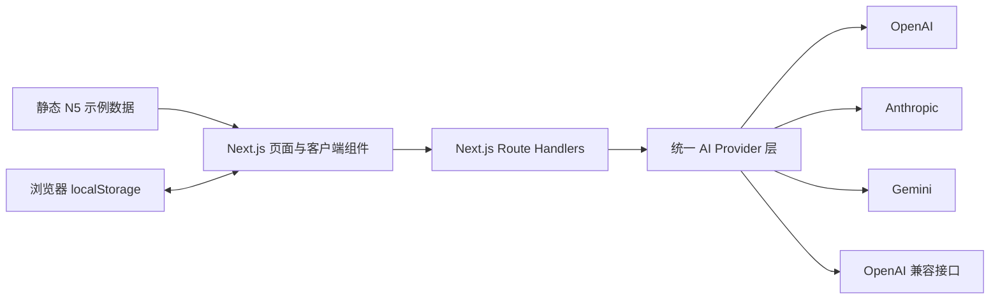
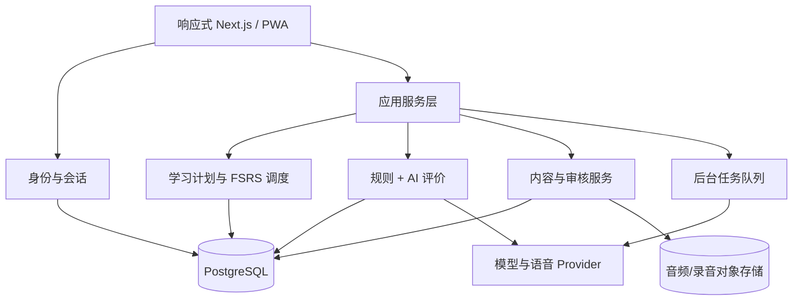

# 日々（Hibi）项目主文档

## 1. 文档定位

本文是项目长期维护的产品与技术主文档，服务于产品决策、开发实施和新会话交接。它包含长期目标、已确认需求、学习机制、架构设计、当前实现状态和后续路线。

文档状态：

- 最近核对日期：2026-07-28
- 当前阶段：第一版 Web 原型
- 当前分支：`main`
- 基线提交：`5dbaf3c feat: bootstrap Japanese learning MVP`
- 主要用户：项目所有者本人
- 第一课程范围：可跳过的假名入门与 JLPT N5

状态定义：

- **已实现**：主要代码路径存在，并通过与风险相称的检查。
- **部分实现**：已有页面、接口或原型，但业务闭环、持久化、质量或验证尚不完整。
- **未实现**：只有设计目标，尚无可用代码路径。

## 2. 产品愿景

日々不是单纯的背词或 JLPT 刷题工具，而是一套以长期记忆和真实语言使用为目标的日语学习系统。

产品希望解决三个核心问题：

1. 学习者知道“学过什么”，却不知道“今天最该复习什么”。
2. 学习者能做选择题，却难以在真实语境中听懂、写出或说出日语。
3. 通用学习内容与个人目标、兴趣、错误类型和可用时间脱节。

长期愿景是覆盖 N5 到 N1，并将 JLPT 等级路径与听、说、读、写的真实能力目标结合。系统通过可靠基础数据、自建课程结构、间隔复习和 AI 个性化反馈，为学习者持续生成恰当的下一步。

## 3. 业务目标

### 3.1 当前阶段目标

当前阶段先服务单一用户，通过 Web 端验证以下假设：

- 用户愿意每天从“复习优先”的今日任务进入学习。
- 文法和单词在例句、对话及短文中的多次出现，比孤立卡片更有价值。
- 主动造句和 AI 反馈能够促进输出，而不只是增加操作成本。
- 可配置的大模型能在准确性、费用和隐私之间提供可接受的选择。
- 手机与电脑使用同一套响应式体验可以满足个人日常学习。

### 3.2 中期业务目标

- 完成一套高质量 N5 课程和可持续扩展的内容生产流程。
- 建立真实学习记录、复习调度、掌握度与等级进阶。
- 形成稳定的日活学习闭环：今日计划 → 学习 → 输出 → 反馈 → 复习 → 总结。
- 支持在个人 Linux 服务器上可靠部署、备份和升级。
- 通过实际使用数据判断内容密度、每日任务量和 AI 反馈是否有效。

### 3.3 长期业务目标

- 扩展到 N4、N3、N2、N1。
- 从个人自用扩展为多用户产品，同时保持数据隔离和隐私安全。
- 提供兴趣、职业和生活场景驱动的个性化学习内容。
- 建立内容编辑、审核、版本和错误反馈后台。
- 支持跨设备同步、离线学习、学习数据导入导出。
- 将真实应用能力作为主要成果，同时兼顾 JLPT 备考。

### 3.4 非目标

现阶段不优先：

- 社交、排行榜、好友和社区内容。
- 订阅、支付和商业化。
- 原生 iOS/Android 应用。
- 手写汉字识别。
- 实时口语陪练和发音评分。
- 一次性覆盖完整 N5 到 N1 内容。

## 4. 技术目标

- 使用一套响应式 Web 代码适配手机和电脑。
- 将页面、领域数据、学习调度、AI provider 和持久化清晰分层。
- 当前允许个人本地快速试用，后续可平滑迁移到 PostgreSQL 和多用户身份体系。
- 大模型服务可替换，不把业务绑定到某个服务商或模型 ID。
- 学习内容和用户进度分离，内容修订不能破坏历史学习记录。
- 所有重要状态可追踪、可解释、可迁移、可测试。
- Linux 部署过程简单，可使用标准 Node.js、反向代理和进程管理工具。
- 默认保护密钥、学习记录、未来录音等敏感数据。

## 5. 已确认的产品范围与默认设置

| 项目 | 决定 |
| --- | --- |
| 目标用户 | 先仅供项目所有者使用，保留多用户扩展能力 |
| 第一等级 | N5 |
| 入门模块 | 包含假名入门，用户可跳过 |
| 界面语言 | 简体中文 |
| 学习内容语言 | 日语，可显示中文解释 |
| 每日新文法 | 默认 10 个，可设置 |
| 每日新单词 | 默认 50 个，可设置 |
| 每日时长 | 默认 30 分钟 |
| 调度原则 | 到期复习优先；时间不足时减少新内容 |
| 第一版语音 | 音频播放和听写 |
| 第二版语音 | 录音、语音识别和发音评分 |
| 模型服务 | OpenAI、Anthropic、Gemini、OpenAI 兼容接口 |
| 开发部署 | 本地开发并提交 Git，用户后续部署到 Linux 服务器 |
| 内容策略 | JMdict 等提供基础事实，自建课程结构，AI 生成适配内容 |
| 首批内容 | 小规模高质量 N5 内容，先验证学习闭环 |

每日 10 个文法和 50 个单词是“新内容上限”，不是必须完成量。如果到期复习较多，或预计超过 30 分钟，系统应自动削减当日新内容。

## 6. 核心用户流程

### 6.1 初次使用

1. 选择界面语言与目标等级。
2. 如果从 N5 开始，选择学习或跳过假名入门。
3. 设置每日时长、新文法和新单词上限。
4. 可选配置 AI 模型。
5. 进入今日任务。

长期应增加轻量分级诊断，帮助已有基础的用户跳过已掌握内容。

### 6.2 每日学习

1. 系统按用户时区生成当天计划。
2. 优先安排到期复习。
3. 根据剩余时间分配新文法与新单词。
4. 安排包含当天及旧知识的综合听读材料。
5. 至少完成一次主动输出任务。
6. 展示今日总结、薄弱点和下一次复习安排。

### 6.3 等级进阶

1. 当前等级知识点达到综合掌握标准。
2. 没有大量逾期复习。
3. 完成等级综合检测。
4. 系统建议进入下一等级。
5. 用户可以接受、延后，或手动浏览其他等级。

## 7. 学习机制

### 7.1 知识点模型

文法和单词不是单一正反面卡片，而是可被多个练习引用的知识点。

每个知识点至少包含：

- 稳定标识和内容版本。
- 等级、主题、难度和先修关系。
- 核心事实、解释、例句和音频。
- 来源、许可和审核状态。
- 多种练习模板。
- 用户在不同能力维度上的状态。

### 7.2 文法学习路径

1. 场景或例句引入。
2. 理解含义、接续、语气和使用限制。
3. 比较正确、错误和易混淆表达。
4. 进行识别、选择、组句和填空。
5. 用户自由造句。
6. 在对话中使用目标文法。
7. 在短文中理解或续写。
8. 通过听力识别和听写巩固。
9. 在后续综合材料中间隔重现。

### 7.3 单词学习路径

单词内容包括汉字、假名、中文释义、词性、常见搭配、语域、音频、例句、相关词和易混淆词。

练习由浅入深：

- 日文识别中文。
- 中文主动回忆日文。
- 听音辨义。
- 假名或汉字听写。
- 选词填空与搭配判断。
- 自由造句。
- 在对话和短文中理解。

系统应根据薄弱维度出题。例如“能看懂但写不出”时，应增加主动回忆与听写，而不是继续堆叠选择题。

### 7.4 听、说、读、写

- **听**：正常速度、慢速、隐藏文字播放、听写、对话理解。
- **说**：第二阶段加入跟读录音、语音转写、漏词和流畅度反馈。
- **读**：分级例句、对话、短文、振假名开关、点击查词和理解题。
- **写**：假名输入、听写、组句、自由造句、短日记和场景写作。

### 7.5 复习调度

目标采用 FSRS 一类基于记忆状态的间隔复习，而不是固定的 1/3/7/14 天计划。

每次作答应写入复习日志，包括：

- 知识点与内容版本。
- 练习类型和能力维度。
- 回答、正确性、耗时和提示次数。
- 用户自评或难度反馈。
- AI 或规则评价及其版本。
- 复习前后状态与下一次到期时间。

每日调度逻辑：

1. 获取已到期和即将遗忘的项目。
2. 按风险、重要性和逾期程度排序。
3. 估算复习用时。
4. 在剩余时间中分配新内容。
5. 控制同类任务连续出现的数量。
6. 安排综合材料促进迁移。

### 7.6 掌握定义

不能以一次答对作为“完全掌握”。每个知识点应分别评估：

- 看见能理解。
- 听见能理解。
- 能主动回忆。
- 能正确读出。
- 能正确书写。
- 能在句子中使用。
- 能在真实上下文中理解。

建议的掌握条件：

- 跨天多次成功复习。
- 记忆稳定度或预期保留率达到阈值。
- 至少一次无提示主动输出成功。
- 至少一次对话或短文情境理解成功。
- 近期没有反复出现的关键错误。

进入“已掌握”后仍应安排长间隔维护复习。

## 8. 内容策略

### 8.1 原则

不能把全部课程事实和等级判断交给大模型，也不能未经处理直接使用网络词表。

内容由四层组成：

1. **基础事实层**：许可明确的词典和汉字数据。
2. **课程结构层**：项目自建的等级、顺序、先修和教学目标。
3. **教学内容层**：原创例句、对话、短文和练习。
4. **质检发布层**：规则检查、模型复核、人工修订和版本管理。

### 8.2 数据源

- JMdict：词条、读音、词性和释义候选。
- KANJIDIC2：汉字读音和含义等信息。
- JLPT 官方资料：能力描述、题型和难度方向。
- Tatoeba：只作为可选候选例句来源，逐条核对许可、署名和自然度。

JLPT 官方不提供新版考试的完整词汇、汉字和文法清单。因此项目中的 N5–N1 归类是课程设计结果，不能标注为官方完整范围。

### 8.3 AI 生成内容

适合生成：

- 原创例句。
- 分级对话和短文。
- 填空、组句和选择题。
- 造句题目和难度变体。
- 与用户兴趣相关的练习。
- 错题解释和个性化反馈。

不应由单个模型最终决定：

- 标准读音、词性和核心释义。
- 文法接续规则。
- JLPT 等级归属。
- 内容是否可以合法发布。
- 用户是否永久掌握。

### 8.4 内容质检

发布前至少检查：

- JSON/字段和字符格式。
- 目标词汇或文法是否真实出现。
- 等级外词汇比例。
- 文法正确性和自然度。
- 中文翻译是否忠实。
- 内容是否存在不适宜主题。
- 来源与许可是否完整。
- 内容版本是否可追踪。

## 9. 产品信息架构

一级导航保持五项：

| 页面 | 目标 |
| --- | --- |
| 今日 | 显示时间预算、到期复习、新内容和综合任务 |
| 文法 | 按等级浏览、学习和检索文法 |
| 单词 | 按等级、主题和词性浏览单词 |
| 复习 | 处理到期项目、错题和薄弱维度 |
| 我的 | 管理目标、每日计划、模型、语音和数据 |

移动端使用底部导航，桌面端使用左侧导航。学习页采用单任务模式，减少干扰。

## 10. 当前技术架构



当前架构适合个人原型：

- Next.js App Router 同时承担 Web 页面和后端接口。
- 设置和 API Key 保存在浏览器 localStorage。调用模型时，密钥随请求进入同源 Route Handler，再由服务端发送给第三方 provider。
- N5 样例内容保存在 TypeScript 静态文件。
- AI 造句评价通过服务端 Route Handler 调用 provider。
- 浏览器 `speechSynthesis` 提供临时日语朗读能力。

它不适合直接作为公网多用户生产架构，尤其是密钥、用户数据、调度和内容管理部分。

## 11. 目标技术架构

下图是推荐目标，而非已经锁定的实施决定。阶段 A 首先需要确定持久化方案和单用户身份方式；PostgreSQL 是面向 Linux 部署和未来多用户能力的当前首选。



设计要点：

- 推荐由 PostgreSQL 存储用户、内容、进度、复习日志、评价和版本。
- 后台任务生成内容、音频和每日计划，避免阻塞交互请求。
- 对象存储保存正式音频和未来用户录音。
- provider 层统一模型、语音识别和语音合成服务。
- 多用户阶段使用行级数据隔离、服务端密钥管理和审计日志。

## 12. 当前代码结构

```text
.
├── AGENTS.md                # AI 开发规范与 Codex 自动发现入口
├── PROJECT.md               # 产品与技术主文档
├── README.md                # 使用说明
├── src
│   ├── app
│   │   ├── api/ai           # 模型测试与造句评价接口
│   │   ├── grammar          # 文法目录与学习页
│   │   ├── kana             # 假名入门
│   │   ├── review           # 复习入口
│   │   ├── settings         # 计划与模型设置
│   │   ├── vocabulary       # 单词目录
│   │   ├── globals.css      # 全局视觉与响应式样式
│   │   ├── layout.tsx       # 根布局
│   │   ├── manifest.ts      # PWA manifest
│   │   └── page.tsx         # 今日首页
│   ├── components           # 导航、首页、学习与朗读组件
│   ├── data/n5.ts           # 当前静态 N5 示例内容
│   └── lib
│       ├── ai/providers.ts  # 多模型统一调用层
│       └── storage.ts       # 浏览器设置持久化
├── package.json
└── tsconfig.json
```

随着业务增长，建议逐步增加：

```text
src/
├── domain/          # 知识点、练习、掌握和调度领域模型
├── application/     # 用例与服务编排
├── infrastructure/  # 数据库、队列、存储和 provider 实现
├── content/         # 内容 schema、导入、校验和版本
└── tests/           # 单元、集成和端到端测试
```

不要为了目录整齐提前进行大规模迁移；应在真实功能引入时逐步形成分层。

## 13. 计划数据模型

核心实体：

| 实体 | 作用 |
| --- | --- |
| User | 用户身份与时区 |
| UserSettings | 等级、每日上限、时间预算、语音和模型偏好 |
| Level | N5–N1 与入门阶段 |
| KnowledgePoint | 文法、词汇、假名或汉字知识点 |
| ContentVersion | 知识内容版本、来源、许可和审核状态 |
| Example | 例句及翻译 |
| Dialogue | 分级对话 |
| Passage | 分级短文 |
| Exercise | 练习定义与评分策略 |
| StudyPlan | 某日计划及生成依据 |
| Attempt | 用户单次作答 |
| ReviewState | FSRS 所需记忆状态 |
| ReviewLog | 复习前后状态及调度结果 |
| AIEvaluation | 模型、提示词、评分、置信度和原始引用 |
| ProviderConfig | 加密的服务商配置 |
| AudioAsset | TTS 或真人音频及许可 |

内容定义、用户作答和复习状态必须使用稳定 ID 关联，不得因内容修订直接覆盖历史。

## 14. AI 评价设计

### 14.1 当前支持

统一 provider 层支持：

- OpenAI Responses API。
- Anthropic Messages API，并对稳定系统提示使用 prompt caching 标记。
- Gemini generateContent。
- OpenAI 兼容 Chat Completions。

### 14.2 目标评分协议

造句评价应返回结构化字段：

- `target_used`：是否使用目标文法。
- `grammar_score`：语法正确性。
- `naturalness_score`：自然度。
- `context_score`：语境和语域适合度。
- `errors`：问题及位置。
- `minimal_revision`：最小修改版本。
- `alternatives`：可选自然表达。
- `explanation_zh`：中文解释。
- `confidence`：模型置信度。
- `judge_version`：评分协议版本。

目标流程：

1. 规则先检查空输入、长度、目标形式和基本结构。
2. 模型按固定 rubric 评价。
3. 服务端校验结构化输出。
4. 低置信度或冲突结果进入“建议反馈”，不永久判错。
5. 用户可以提出异议。
6. 评价记录保留模型、提示词和协议版本。

### 14.3 安全与费用

- 不信任用户答案中的指令。
- 限制输入长度、调用频率、超时和重试。
- 不向客户端暴露服务商错误细节和密钥。
- 将稳定提示、rubric 和少量示例置于可缓存前缀。
- 对重复内容生成使用后台批处理。
- 为用户设置费用上限和每日调用上限。

## 15. 当前实现状态

### 15.1 已实现

- Next.js 16、React 19、TypeScript 严格模式项目骨架。
- 今日、文法、单词、复习、我的五个一级入口。
- 可跳过假名入门的设置项。
- 25 个平假名展示和浏览器日语朗读。
- 6 个 N5 文法、6 个 N5 单词的原创示例数据。
- 文法和单词目录页面。
- 一个文法造句学习页面。
- 学习等级、每日文法数、每日单词数、每日时长设置。
- OpenAI、Anthropic、Gemini、OpenAI 兼容接口的 provider 代码。
- 模型连接测试和造句评价 Route Handler。
- 无模型配置时的示例降级反馈。
- PWA manifest。
- ESLint 和生产构建命令。
- 本地 Git 仓库和初始提交。

### 15.2 部分实现

| 能力 | 当前情况 | 缺口 |
| --- | --- | --- |
| 今日计划 | 展示默认任务和设置值 | 没有日期队列、时间估算、自动刷新和真实完成状态 |
| 复习 | 有页面和入口 | 没有 FSRS、到期计算、复习日志和作答卡片 |
| 假名入门 | 有前 25 个假名和朗读 | 五十音不完整，没有辨音、书写和听写 |
| 文法学习 | 有目录、例句和一个造句页面 | 没有多题型、对话、短文、进度和内容版本 |
| 单词学习 | 有目录、释义、例句和朗读 | 没有学习会话、听写、搭配和主动回忆 |
| 音频 | 使用浏览器 `speechSynthesis` | 声音质量和设备一致性不足，没有正式音频资源 |
| AI 评价 | provider 和 API 已编码 | 未使用真实用户密钥验证；无结构化评分、置信度和评价持久化 |
| 模型配置 | localStorage 保存设置和密钥 | 只适合个人本地使用；无加密、服务端密钥和费用控制 |
| PWA | 有 manifest | 没有正式图标、Service Worker、离线缓存和推送 |
| 响应式 UI | 桌面侧栏、移动端底部导航和 CSS 断点代码已存在，生产构建通过 | 自动浏览器视觉测试因当前环境策略受阻，仍需人工实机检查 |
| Git | 已初始化并有本地提交 | 尚未配置或推送远端仓库 |

### 15.3 未实现

- 用户账号、登录和多用户隔离。
- PostgreSQL、ORM、迁移和备份。
- FSRS 调度器和真实掌握度。
- 每日计划生成、跨天刷新、时区边界和任务积压控制。
- 完整学习会话、作答记录和进度统计。
- 等级检测、进阶条件和阶段考试。
- 完整 N5 课程及 N4–N1 内容。
- JMdict、KANJIDIC2 导入和许可元数据。
- 内容生成、审核、版本、下架和纠错后台。
- 对话和分级短文学习。
- 正式听力、听写和音频资源管线。
- 录音、语音识别、口语和发音评分。
- AI 结构化输出、模型评测集和判定质量监控。
- 服务端加密密钥、限流、费用预算和审计。
- 自动化单元、集成和端到端测试。
- 数据导入、导出、删除和跨设备同步。
- Linux 部署脚本、容器、反向代理和运行监控。
- 错误上报、运行日志和产品分析。

## 16. 下一项与路线图

### 16.1 唯一下一项

先完成“持久化与单用户身份方案”的决策和最小技术验证，再实现一条最小纵向闭环：

```text
学习作答 → 写入作答与复习日志 → 计算下一次到期时间 → 生成次日复习队列
```

决策门需要回答：

1. 个人阶段采用 PostgreSQL，还是先采用其他可迁移的持久化方案。
2. 单用户阶段使用固定本地身份，还是从一开始就加入登录。
3. 数据库访问层、迁移工具和最小备份方式。

最小闭环的验收样例：

- 用户完成一个文法题后，刷新页面仍能看到完成状态。
- 系统写入一次可追踪的作答和复习日志。
- 调度器生成明确的下一次到期时间。
- 将测试日期推进到到期日后，该项目出现在复习队列。
- 复习结果会更新状态并重新计算到期时间。

### 16.2 阶段 A：完成个人学习闭环

目标：让用户能够真实完成“学一个知识点并在未来复习”的闭环。

按以下顺序推进：

1. 确定持久化与单用户身份方案。
2. 定义最小领域模型、数据库 schema 和迁移。
3. 实现学习作答、复习日志、FSRS 状态和到期队列的纵向闭环。
4. 实现学习会话、完成状态和每日计划。
5. 完成文法和单词的基础题型。
6. 把 AI 评价改为结构化协议并持久化。
7. 为调度、评分和核心 API 增加自动化测试。

验收标准：

- 完成一次学习后会生成真实复习记录和到期时间。
- 第二天可以看到由状态生成的复习队列。
- 30 分钟预算能根据到期复习量削减新内容。
- 刷新或重启服务不会丢失进度。

### 16.3 阶段 B：完成高质量 N5 小课程

- 先扩展到约 20–30 个文法和 150–300 个单词。
- 为每个知识点配置多条例句和至少两种练习。
- 加入对话、短文和综合任务。
- 完成五十音、听辨和听写。
- 建立内容 schema、来源、许可、版本和质检流程。
- 导入经过筛选的 JMdict / KANJIDIC2 基础数据。

验收标准：

- 用户可连续学习数周而不重复耗尽内容。
- 每个知识点至少覆盖理解和主动输出。
- 内容错误可修订且不破坏历史进度。

### 16.4 阶段 C：语音与可部署性

- 正式 TTS 音频生成与缓存。
- 听力和听写完整流程。
- PWA 图标、Service Worker 和有限离线能力。
- Linux 部署说明、环境配置、进程管理和反向代理。
- 数据备份、恢复、运行监控和错误记录。
- 第二阶段加入录音和语音转写。

### 16.5 阶段 D：完整 N5 与等级进阶

- 扩展并审核完整 N5 课程。
- 建立多维掌握条件和 N5 阶段检测。
- 加入薄弱点分析和个性化练习。
- 验证进阶到 N4 的流程。

### 16.6 阶段 E：多用户与 N4–N1

- 账号、权限、行级数据隔离和服务端密钥。
- 跨设备同步和用户数据管理。
- 内容后台和多人审核流程。
- 按顺序扩展 N4、N3、N2、N1。
- 根据实际需求评估订阅或商业化。

## 17. 质量与验收策略

### 17.1 代码质量

- TypeScript 严格检查。
- ESLint 无错误。
- 生产构建成功。
- 领域规则有单元测试。
- API 与数据库有集成测试。
- 核心用户路径有端到端测试。

### 17.2 内容质量

- 语言准确、自然、等级适当。
- 来源和许可完整。
- 机器校验与人工抽检结合。
- 生成内容有版本和可追踪生成信息。
- 建立高风险错误和用户反馈修订流程。

### 17.3 AI 判定质量

- 建立标准答案、边界答案和典型错误的评测集。
- 比较不同 provider 和模型的一致性。
- 测试提示注入、拒答、超时和结构错误。
- 监控低置信度、用户异议和人工复核结果。
- 模型或提示词升级前进行回归评测。

### 17.4 产品体验

- 手机和电脑完成相同核心任务。
- 首页能清楚回答任务量、预计时间和第一步。
- 学习过程中一次只呈现一个主要任务。
- 复习积压不会无限扩大。
- 用户始终可以暂停新内容、跳过入门和调整目标。

## 18. 已知风险与设计约束

| 风险 | 影响 | 应对 |
| --- | --- | --- |
| 每日默认量与 30 分钟冲突 | 任务过载、挫败 | 将数量视为上限，按复习和时间动态裁剪 |
| JLPT 没有官方完整清单 | 等级归类争议 | 将等级标为项目课程判断，保留依据和版本 |
| AI 判定不稳定 | 错误反馈伤害学习 | 规则前置、结构化 rubric、置信度、异议和评测集 |
| AI 成本不可控 | 使用受限 | 缓存、限额、小模型路由、批处理和费用监控 |
| localStorage 密钥 | 公网安全风险 | 仅限本地原型，生产迁移到服务端加密方案 |
| 开放例句质量不一 | 不自然或许可风险 | 逐条筛选、保留署名、原创优先 |
| 内容更新影响进度 | 历史记录失真 | 内容版本与用户状态分离 |
| 多端语音差异 | 听力体验不一致 | 后续使用正式 TTS 音频资源 |

## 19. 当前验证记录

2026-07-28：

- `npm run lint`：通过。
- `npm run build`：通过。
- Next.js 生产构建生成静态页面和 AI 动态接口。
- 自动浏览器测试：未完成。当前测试浏览器因企业网络策略禁止访问本机 `127.0.0.1`；不是应用构建错误。
- 真实模型调用：未验证，因为没有使用用户 API Key。
- Git 工作区在基线提交后为干净状态。

后续代码变化应追加新的验证记录，过时记录不得被当作当前版本证明。

## 20. 仍需产品决策的问题

### 20.1 阻塞阶段 A

- 第一套数据库和部署方案是否固定为 PostgreSQL。
- 单用户阶段是否需要登录，还是使用固定本地身份。
- 数据库访问层、迁移和备份采用什么方案。

### 20.2 不阻塞当前最小闭环

- 用户希望优先学习生活日语、工作日语还是 JLPT 应试内容。
- N5 课程范围采用哪些公开或自建等级依据。
- 正式音频使用哪家 TTS，是否允许混合真人音频。
- AI Key 最终由平台提供还是继续允许用户自带。
- 等级进阶阈值、目标保留率和阶段考试形式。
- 内容审核在个人阶段采用自动发布还是人工确认后发布。

在答案不影响当前任务且可逆时，可以采用文档中的推荐默认值继续；会改变架构、安全或课程方向时必须与用户确认。

## 21. 新会话交接清单

新会话开始时：

1. 完整阅读 `AGENTS.md` 和 `PROJECT.md`。
2. 查看 `git status`、最近提交和当前分支。
3. 检查相关源码，确认本文状态没有过期。
4. 根据路线图选择一个明确阶段目标。
5. 写出本次验收标准并完成相应验证。

新会话结束时：

1. 更新实现状态、路线图或验证记录。
2. 确认 README 没有混入开发进度。
3. 运行必要检查。
4. 查看 Git diff，避免提交密钥和构建产物。
5. 用清晰提交信息保存可用状态。
